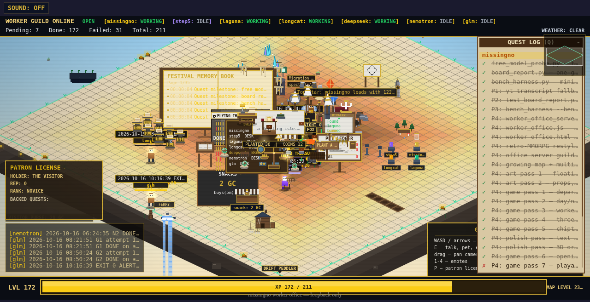
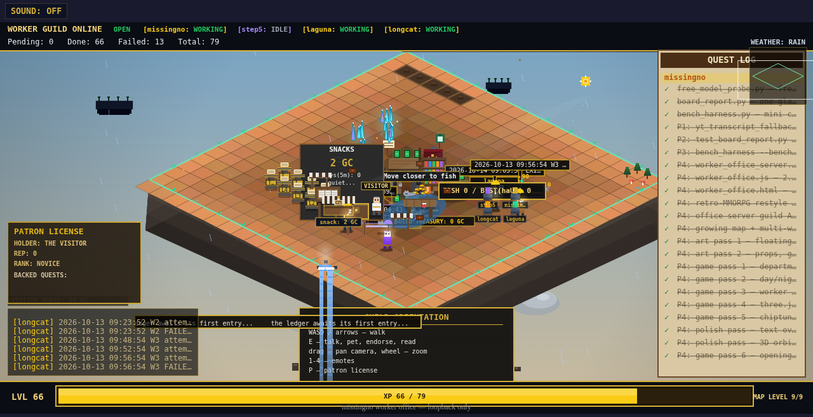
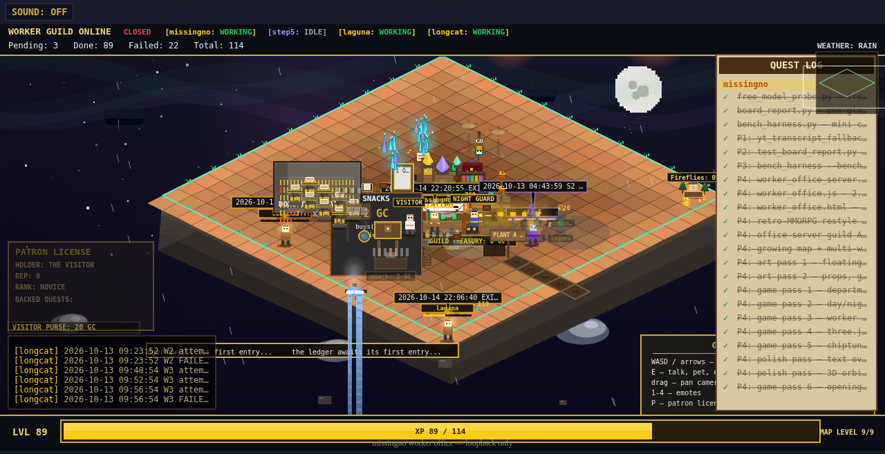
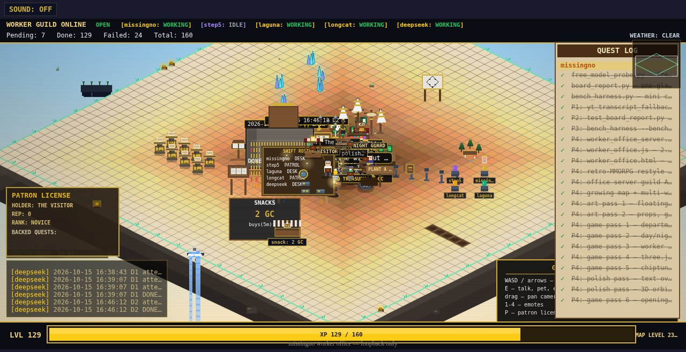
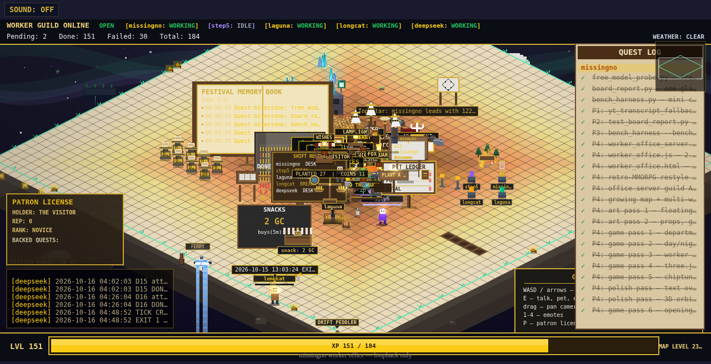

# always-on-agent-city

An autonomous fleet of **free AI models** that built — and then ran — a living pixel-art MMORPG-style worker colony, around the clock, for ~$0.

<div align="center">
  
  <p><em>The island at its final state: districts, economy, museum, heroes' plaza, sky isles.</em></p>
</div>

Over three days (Oct 12–16, 2026), a "guild" of zero-cost LLM workers chartered, built, verified, and shipped **211 quests of real, working game code** — a playable floating-island colony with an economy, exhibits, weather, conversations, and a design-review organ that critiqued its own output — while the entire supervisor layer cost **$1.14** of paid-model fallback on a $2/month cap.

**No one wrote game code by hand. Every module was generated by a free model, gated by automated verification, and committed by a bot.**

---

## The story in screenshots

| | |
|---|---|
| **Day 2 — the camp** | **Day 2 evening — first district push** |
|  |  |
| **Day 3 — the Great Buildout** | **Day 4 — the Great Resize (48×48 map)** |
|  |  |

*(All 9 timeline captures live in [`docs/screenshots/`](docs/screenshots/) — they were taken by the colony's own **Director** organ, which screenshotted and reviewed the island every 6 hours.)*

## What actually got built

- **211 quests chartered, 172 shipped** across **249 git commits** — every quest is one commit, fully bisectable history
- The fleet **grew itself from 4 to 7 workers** — the Foreman scouted DeepSeek, Nemotron, and GLM-flash on its own; DeepSeek shipped 30 quests
- A working game: 48×48-tile island, ~93 live ES modules — economy (wages, prices, treasury), quest museum, worker conversations, weather, fishing, market, night guard, districts, aurora
- **The rails underneath** (the reusable part): verify gates, extraction hardening, failure breakers, an escalation ladder to a paid model on transport failure only, a syntax-gated module manifest, a keepalive, and a Foreman/Director review loop

## How it worked

```
                    ┌──────────────────────────────┐
                    │   ROADMAP.md  (the charter)   │
                    │  boundaries, themes, districts│
                    └──────────────┬───────────────┘
                                   │
        ┌──────────────────────────┼───────────────────────────┐
        ▼                          ▼                           ▼
┌──────────────┐         ┌────────────────┐          ┌────────────────┐
│   FOREMAN    │ seeds → │  WORKERS (7)   │ build →  │    VERIFY      │
│  (2h agent)  │ quests  │ free LLM API   │ modules  │ node --check + │
│ invents work │         │ windows, $0    │          │ probe harness  │
└──────▲───────┘         └────────────────┘          └───────┬────────┘
       │                                                      │ pass
       │ critique + new findings                              ▼
┌──────┴────────┐        ┌────────────────┐          ┌────────────────┐
│   DIRECTOR    │        │   ORCHESTRATOR │ ◄────────│  GIT COMMIT    │
│ (6h agent,    │ ─────► │  wiring + QA   │          │ one per quest  │
│ own browser   │        │ (this repo's   │          └────────────────┘
│ eye, canon)   │        │  author)       │
└───────────────┘        └────────────────┘

Failure path: free window fails twice → escalate to paid GLM-5.3 → same verify gate
              → cost logged to spend.json ($1.14 total of a $2/mo cap)
```

- **Boards as state**: each worker has a JSON board (`board_*.json`) — quests with status, attempts, a tight spec, a target file, and a `verify_cmd`
- **The verify gate is the intelligence**: on tight specs, free decisive models tied expensive "thinkers" on quality (our bell-tower bench: quality tie at 6.7s / 18.8s / 380s)
- **Organ separation**: the Foreman invents work, workers build, the Director critiques screenshots against a design canon (`GAME_CRAFT.md`), code verifies — nobody polices themselves
- **Chartered autonomy**: workers never invent goals; the charter constrains *what kind* of thing can be built, the Foreman decides *what*, the Director decides *whether it's good*

## Repo map

| Path | What it is |
|---|---|
| `tasks_out/worker_office.js` | The game client (isometric renderer, workers, camera, HUD) |
| `tasks_out/worker_office_server.py` | Tiny HTTP server — serves the page, `/api/board`, and a syntax-gated `/api/modules` manifest |
| `tasks_out/worker_loader.js` | Self-updating loader — fetches the manifest, imports every valid module |
| `tasks_out/worker_*.js` | ~150 worker-built modules (economy, banter, museum, market, rain, aurora, statues…) — each one a shipped quest |
| `board_*.json` | The workers' quest boards (state of the fleet) |
| `ROADMAP.md` | The charter — themes, hard boundaries, the districts rule |
| `GAME_CRAFT.md` | The design canon the Director reviews against (five-second test, juice hierarchy, label discipline…) |
| `LAYOUT.md` | The town plan — district coordinates |
| `DESIGN_FINDINGS.md` | The Director's review log |
| `docs/screenshots/` | The Director's 9 captures — the island's visual timeline |
| `spend.json` | The escalation ledger ($1.14 / $2.00 cap) |
| `logs/` | Tick logs — every build attempt |

## Run it

```bash
cd tasks_out
python3 worker_office_server.py --port 8798
# open http://localhost:8798 — WASD/arrows to move, E to interact, drag to pan
```

The workers need an OpenAI-compatible API with free windows and a `models` endpoint; their tick scripts lived outside this repo (cron-driven), reading an auth file at runtime.

## Lessons (the short version)

1. **Cheap models are good enough when the spec is precise.** Quality tied; route by speed and cost, not "smartness".
2. **Think once, execute many.** One tight spec beats ten loose prompts. Escalate on failure, not by default.
3. **Canary ≠ load test.** A tiny probe said the slow models were fine; real prompts revealed they'd never finish.
4. **Failed outputs leave poison residue.** Broken files from failed quests stalled the whole client until the manifest learned to syntax-gate.
5. **Things fail silently.** The game server died with exit code 0 and no witness — only the Director's scheduled screenshot caught it.
6. **Autonomy needs organs, not just agents.** Invention, execution, critique, and verification were separate; that's why it ran unsupervised for days without rotting.
7. **Somebody has to own "make it good."** Left alone, the workers kept *adding* until the map became unreadable. Building more is easy; judging takes an owner.

---

*Built by an autonomous worker guild orchestrated by [Hermes Agent](https://hermes-agent.nousresearch.com). Charter, quests, and every line of game code in `tasks_out/` were machine-generated on free inference windows; total paid-model spend: $1.14.*
